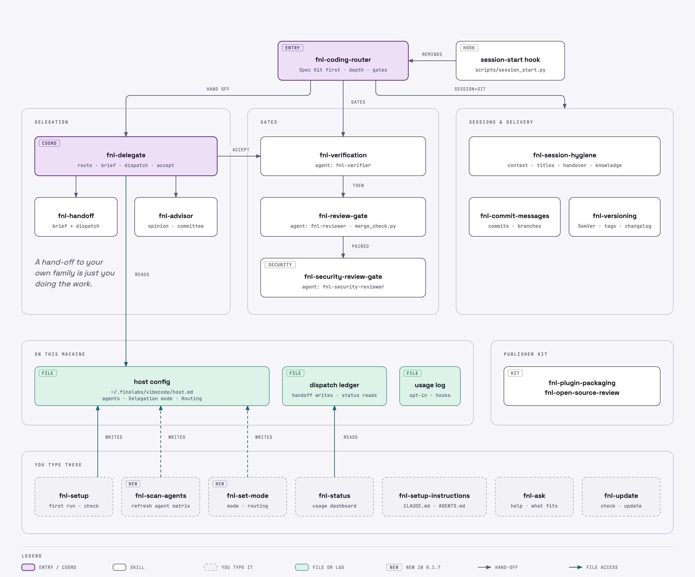
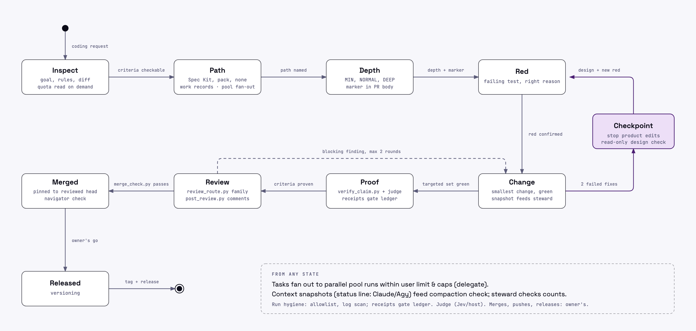
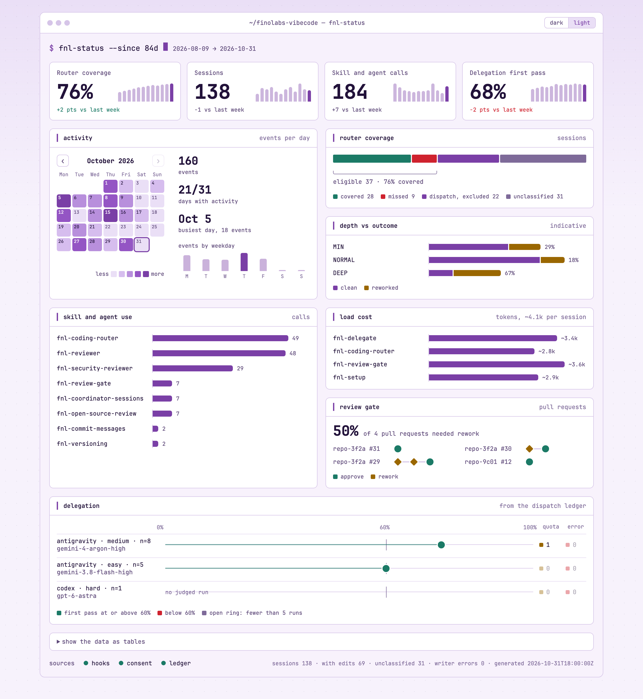

# finolabs-vibecode

**In plain words.** finolabs-vibecode is a safety and quality layer for your AI coding assistant (Claude Code, Codex or Antigravity). It makes the assistant decide how careful to be before it changes anything, get a second opinion on its work, check that it really runs, and tell you what happened in everyday words. You describe what you want; you do not need to know Git or use a terminal.

**What you hand over, and what stays with you.** You hand over the task. Once set up, the assistant handles the routine within the task and the permissions you give it: it plans, picks how careful to be, runs what it built and arranges a second look at the change. It uses `fnl-advisor` for one second opinion or a committee, `fnl-delegate` for task coordination, and `fnl-session-hygiene` for handovers and shared decisions. It asks you when a decision or action needs your approval, and it tells you what it could not verify. You can change how much runs on its own: see [Bricks, not a framework](#bricks-not-a-framework).

## Start in 3 minutes (you)

On Codex, use `$` instead of `/` for every skill command below. Claude Code and Antigravity use `/`.

1. **Ask your AI assistant to install it.** Paste this into your assistant's chat: "Install https://github.com/finolabs/finolabs-vibecode for me, and explain each step before you do it."
2. **Open a new chat.** Plugins load when a chat starts.
3. **Type `/fnl-ask`.** (Claude Code may show it as `/finolabs-vibecode:fnl-ask`.) It tells you in plain words where to start, and you can ask it anything about the plugin.
4. **Type `/fnl-setup` and choose Quick.** It asks a few plain questions and changes nothing without your yes.
5. **Check that setup worked.** Type `/fnl-setup` again and choose Check. It reads your setup, says in plain words what will run on its own and what will ask you first on your host, and lists what is missing. Anything it cannot see from files, it marks unverified.
6. **Say what you want to build, in your own words.** For example: "I run a small shop and want a page that tracks my stock and turns red when an item runs low." The assistant plans it, builds it, checks it and tells you where to see it.
7. **Later, once you have a first result:** type `/fnl-setup-instructions` to teach your assistants how you like to work (on Codex, type `$fnl-setup-instructions` right after step 4), and `/fnl-status` after a few chats to see how it is going.

## Words you may see

| You may see | It means |
| --- | --- |
| depth (MIN, NORMAL, DEEP) | how careful the assistant is being: a quick tweak, a normal change or a big one |
| review, security review | a second pair of eyes before a change counts, and a safety check for private data and logins |
| commit | a save point |
| pull request | a proposal to add a change to a project |
| branch, worktree | a separate copy to try things safely |
| Spec Kit | a way of writing a plan before building |
| delegate, agent | another AI helper |

## For engineers

One engineering practice for AI coding agents, packaged as a single plugin with a focused skill set. It tells an agent how to route a change, how deep to go, how to delegate to other agents and accept their work, how to commit, version and release, and which review and verification gates a change must pass.

This pack owns the decisions between tools: routing, depth, delegation, gates and conventions. For the work itself it points to trusted skills and native commands from known publishers (Matt Pocock's skills, Cloudflare's security audit, Spec Kit, each host's own review commands) instead of rewriting them, and every such pointer carries a fallback that keeps the skill working when the companion is not installed.

### How the skills fit together

<p align="center">
  <picture>
    <source media="(prefers-color-scheme: dark)" srcset="assets/skills-architecture-dark.png">
    
  </picture>
</p>

### Life of a change

<p align="center">
  <picture>
    <source media="(prefers-color-scheme: dark)" srcset="assets/task-lifecycle-dark.png">
    
  </picture>
</p>

The sources of both diagrams are in [`docs/diagrams/`](docs/diagrams/).

### Bricks, not a framework

The pack is a set of small skills that each do one job, plus a guideline that shows how we combine them. Follow the guideline, or assemble your own set.

The modular approach was inspired by the LEGO Group's turnaround under Jørgen Vig Knudstorp: a small set of parts that fit together. This project is independent of, and is not sponsored or endorsed by, the LEGO Group. LEGO is a trademark of the LEGO Group.

The main preferences are yours. They live in host config: `## Delegation mode`, `## Routing` and `## Agents on this machine`. Setup asks about them:

- **Delegation mode.** `manual`: other agents get work only when you say so. `suggest` (default): the agent names who could take a task and waits for your yes. `auto`: it hands off bounded tasks by the guideline, records the decision in the ledger and tells you after.
- **Agents.** Present agent families and user-confirmed allowed models. Delegation uses only present families; with no other family present it is off. A missing inventory keeps previous behavior and suggests a scan; an inventory older than 30 days prompts a stale warning once per session.
- **Routing.** `on` (default) or `off`. Off removes the session-start reminder that sends the agent to `fnl-coding-router`; the skill still works when called by name.

For Delegation mode `auto`, `/fnl-set-mode auto-gate on` offers a separate opt-in with a clear Yes or No. On Claude Code, the installed hook may deny the first file write in a repository without a decision in the last 8 hours; a recorded decision or prior denial allows later writes in that window, and expiry can cause one more denial. The hook allows on errors. It does not cover shell commands and is not an approval or security control. Turn it off with `/fnl-set-mode auto-gate off` or `FNL_AUTO_GATE=off`. Antigravity and Codex have no auto gate declaration; agent judgment remains advisory there. Real-session delivery of this implementation is not verified.

Type `/fnl-scan-agents` to refresh which helpers are on this machine, and `/fnl-set-mode` to see or change Delegation mode and Routing; both show changes and ask for a clear yes before writing. Environment overrides (`FNL_DELEGATION_MODE`, `FNL_ROUTING`) win over the file; the mode command says when a write has no effect.

Before an agent edits a repository you care about, type `/fnl-restore-point` to save its current state to a private git ref (nothing is pushed and your branch and files are untouched); it lists the saved points and restores one only after showing the difference and your clear yes.

These settings govern hand-offs to another model family. Own-family sessions or headless runs follow project rules and may start without an offer for a project requirement or to spare context, with a one-line reason; they retain delegate authority limits. No setting weakens a gate: the review gates and the never-delegated list in `fnl-delegate` (merges, pushes, deploys, secrets) apply in every mode. What a setting guarantees depends on the host. It is agent judgment unless a hook or a host setting backs it; Codex hooks need your trust; Antigravity's always-on rule is a static file that Routing cannot switch off. So `auto` is never 100% automatic. `/fnl-ask` explains this in plain words, and `/fnl-setup` Check shows what your host enforces.

Suggested combinations, not presets (nothing selects a build for you):

| Build | What you get | Skills |
| --- | --- | --- |
| **Solo** | One implementer that plans before editing, proves its work and writes clean commits | `fnl-coding-router`, `fnl-verification`, `fnl-commit-messages` |
| **Reviewed** | Solo, plus pull requests held for posted code and security reviews | Solo + `fnl-review-gate`, `fnl-security-review-gate` (and the `fnl-reviewer` and `fnl-security-reviewer` agents, which only the plugin install carries) |
| **Whole team** | Reviewed, plus coordination of the agents you have | Reviewed + `fnl-delegate`, `fnl-handoff`; optionally `fnl-advisor`, `fnl-status` |
| **Your own** | Any subset that fits how you work | Any skills; the delegation family needs `fnl-delegate` beside it |

Start any of them with `/fnl-setup` (on Codex, also `$fnl-setup-instructions` right after). The lifecycle skills (`fnl-session-hygiene`, `fnl-versioning`, `fnl-update`, `fnl-open-source-review`, `fnl-plugin-packaging`) fit any build when needed. Not sure? `/fnl-ask` shows what each skill gives you and what you lose without it.

Published by [FINOLABS](https://github.com/finolabs) and listed in its plugin catalog, [finolabs/plugins](https://github.com/finolabs/plugins). Maintained by [Fioenix](https://github.com/fioenix).

It targets Claude Code, Codex and Antigravity from one `skills/` folder. Latest release: [`v0.1.7`](https://github.com/finolabs/finolabs-vibecode/releases/tag/v0.1.7) (phase 0; see `fnl-versioning`). Between releases, `main` carries the next version with `-dev`.

<p align="center">
  <picture>
    <source media="(prefers-color-scheme: dark)" srcset="assets/dashboard-dark.png">
    
  </picture>
</p>

The dashboard `fnl-status` opens, drawn here from synthetic numbers. It reads your dispatch ledger and, once you consent in setup, local usage metadata that never leaves your machine ([PRIVACY.md](PRIVACY.md)).

The quickest install: give your coding agent this repository's link and ask it to install the plugin. The next section tells it how.

## For AI agents: install and set up

You were given this repository's link to install it for the user. Follow these steps in order.

1. **Find your host**: Claude Code, Codex, Antigravity, or another agent that reads Agent Skills.
2. **Confirm with the user before installing.** The install changes their agent configuration for every project. Offer the whole plugin by default; it carries the skills, the agents, the session reminder and the hooks for the optional usage metrics (off until the user consents). Offer single skills as the alternative (see [Single skills, any agent](#single-skills-any-agent)). Install only one of the two for an agent, since both together list every skill twice.
3. **Check for an existing install first**: run `claude plugin list` and `claude plugin marketplace list` (or `codex plugin list` and `codex plugin marketplace list`). If `finolabs-vibecode` is already installed from another catalog, such as `finolabs-vibecode@finolabs-vibecode`, or Codex lists the older `Finolabs` catalog, stop and ask the user before switching: two installs list every skill twice, and on Codex the older catalog shares a cache folder with `finolabs`. The [finolabs/plugins README](https://github.com/finolabs/plugins#codex) has the migration.
4. **Install from a shell** with your host's commands:

   | Host | Commands |
   | --- | --- |
   | Claude Code | `claude plugin marketplace add finolabs/plugins`, then `claude plugin install finolabs-vibecode@finolabs` |
   | Codex | `codex plugin marketplace add finolabs/plugins`, then `codex plugin add finolabs-vibecode@finolabs` |
   | Antigravity | `agy plugin install https://github.com/finolabs/finolabs-vibecode` |
   | Other agents | `npx skills add finolabs/finolabs-vibecode -a <agent>` |

5. **Verify** that `claude plugin list`, `codex plugin list` or `agy plugin list` shows `finolabs-vibecode`. Report the command output to the user, and report any failure as it is.
6. **Hand over to the user.** Plugins load when a session starts. Tell the user, in one message and in this order: open a new session; type `/fnl-ask` (`/finolabs-vibecode:fnl-ask` on Claude Code, `$fnl-ask` on Codex); then `/fnl-setup` and choose Quick (`$fnl-setup` on Codex). Only the user can start these, because setup interviews them before it writes host config and instructions. Tell them `/fnl-setup-instructions` (choose user scope for their working contract) comes after their first result, except on Codex, where it comes right after setup.
7. **After the first result, offer the companions and install them only if the user agrees:** [Matt Pocock's skills](https://github.com/mattpocock/skills) and [Cloudflare's `security-audit`](https://github.com/cloudflare/security-audit-skill) (see [Works well with](#works-well-with)). Every skill works without them.

Done when the plugin is listed by your host and the user knows the order: `/fnl-ask`, `/fnl-setup` (Quick), a first real task, `/fnl-setup-instructions` (immediately after setup on Codex), then `/fnl-status` later.

### For AI agents: working with a new user

- **Start coding work with `fnl-coding-router`.** On Claude Code and Codex a session-start reminder prompts it (unless Routing is off, and Codex hooks need the user's trust) and on Antigravity an always-on rule does; on Codex the user's instructions should also point at it (`$fnl-setup-instructions`).
- **A user who says they are new to coding or not technical** should type `/fnl-ask` first: it loads the plain-language register, and you keep it for the rest of that conversation. Suggest it once; never start setup for them.
- **Speak in everyday words, lead with the result, and ask only the user's own decisions.** Every check and gate still runs; only the wording changes.


## Skills

The plugin has **20 skill folders**: 12 model-visible skills and eight user-only skills. Every skill carries the `fnl-` prefix. The user types eight of them, `fnl-restore-point`, `fnl-scan-agents`, `fnl-set-mode`, `fnl-setup`, `fnl-setup-instructions`, `fnl-status`, `fnl-update` and `fnl-ask` (`/fnl-setup` on Claude Code and Antigravity, `$fnl-setup` on Codex); `fnl-handoff` and `fnl-advisor` can be typed too. The agent loads `fnl-handoff` directly through `fnl-delegate`, proposes `fnl-advisor` for one opinion or a committee for the user to approve, and loads the rest when the situation calls for them.

| Skill | Use it when |
| --- | --- |
| `fnl-coding-router` | Starting or resuming any coding work, in any repository: depth (MIN, NORMAL, DEEP), review and security gates, proof, the stop-before-a-third-fix checkpoint, and a workflow path for Spec Kit (with its depth gate), mattpocock/skills, obra/superpowers, or none. |
| `fnl-session-hygiene` | Keeping sessions healthy: context pressure, phase changes, stale titles, handovers, and remembering or recalling decisions, lessons and project state in one shared knowledge base (Orrery or an Obsidian vault); code facts stay in the repository. |
| `fnl-delegate` | Coordinating Claude Code, Codex and Antigravity from whichever one you run in: grading on five levels with one decision matrix (tier, effort, budget, who accepts), routing by agent and model through a dated capability map, an optional route judge, quota fallback, at most 5 parallel runs, time budgets, liveness from artifacts, the heavy-job lock, verify-before-accept, handover and the dispatch ledger; running a spec as a coordinator with one app session per task, standby sessions and review gates. |
| `fnl-handoff` | Writing a self-contained brief and dispatching one task, or saving a handover through session hygiene so a later session or another agent continues the work. |
| `fnl-advisor` | Getting one second opinion from another model family, or convening two contrasting families for root-cause analysis and a plan when stuck or looping; both are read-only and spend quota, with approval governed by their procedure. |
| `fnl-versioning` | Bumping a version, tagging a release, or writing the changelog and release notes: SemVer, `0.y.z` until a stable release is declared, immutable `vX.Y.Z` tags, Keep a Changelog. |
| `fnl-commit-messages` | Committing, writing a pull request description, or working with branches: atomic commits, imperative subjects, no secrets or build output, the host attribution trailer, and the branch flow (naming, base, sync, conflicts, merge, cleanup, backports). |
| `fnl-restore-point` | Saving the working tree to a private git ref before the agent edits, listing restore points and restoring one after a preview and a yes. User-invoked, git repositories only. |
| `fnl-review-gate` | A user story is done or a pull request is about to merge: an independent code review, a disposition for every finding, a regression test per runtime fix. |
| `fnl-security-review-gate` | A change touches auth, permissions, private data, untrusted input or payments: a permission-boundary review, with negative tests proving that not even a record's existence leaks. |
| `fnl-verification` | Choosing targeted tests, reading the evidence, accepting someone else's work, claiming done. |
| `fnl-plugin-packaging` | Packaging skills as a plugin for Claude Code, Codex and Antigravity from one repository: layout, manifests, icon, marketplaces, checks. |
| `fnl-scan-agents` | Refreshing the local inventory of Claude Code, Codex and Antigravity, with user-confirmed allowed models and a yes before writing host config. |
| `fnl-set-mode` | Showing or changing Delegation mode and Routing, their sources and environment overrides, with a yes before writing. |
| `fnl-setup` | First run on a machine or repository: host config, local file placement, the agent-skills block in `CLAUDE.md` or `AGENTS.md`. |
| `fnl-setup-instructions` | Writing user-scoped working contracts, project-scoped repository context, or both: it interviews you and keeps one source per scope for Claude Code, Codex and Antigravity. |
| `fnl-status` | Opening the usage dashboard: router coverage, skill and agent use, load cost, depth against review outcome, delegation and the review gate, from the usage events (after you consent in setup) and the dispatch ledger. It also lists delegated runs still open. |
| `fnl-update` | Showing installed and cached available versions, updating through the host after a clear yes, skipping a release, or stopping update notices. |
| `fnl-ask` | You are new and do not know where to start, want to know what the plugin holds, or have a question about a skill, agent or script: it gives the first steps, lists the contents, explains the piece you name, or maps your situation to the next command, including companion skills from other packs. |
| `fnl-open-source-review` | Before a repository goes public, and after: license, secrets in tree and history, internal leaks, clean payload, community files, repository settings, identity, data flow, plugin checks. |

### Agents

The read-only subagents in `agents/` apply the skills above in a fresh context. Each answers a different question:

| Agent | Question | Use it when |
| --- | --- | --- |
| `fnl-verifier` | Is the report true? | An agent or session says a task is done: it reruns the targeted tests, checks each acceptance criterion, and confirms the commits are where the report says. It judges facts, not design. |
| `fnl-reviewer` | Is the change good? | A pull request or story is ready: it reads every changed file, then the callers, dependencies, contracts and tests the change affects, under `fnl-review-gate`. |
| `fnl-security-reviewer` | Is the change safe? | The change crosses a sensitive boundary: it reads the changed files, then every trust path that reaches them, under `fnl-security-review-gate`. |

Both reviewers cover two rings, the change and its impact set, rather than the whole repository, and report what they traced. Delegated work is accepted only after the verifier checks it. A pull request merges only after the reviewer and the security reviewer have each posted an approving review comment for its current head commit; a push after a review needs a new review. Where a repository adopts the low-risk lane, a pull request that only edits documents written for people (such as this README or the changelog) or bumps manifest versions takes one pass by the reviewer, which posts both comments; a script decides which pull requests qualify. `skills/fnl-review-gate/scripts/merge_check.py` runs the merge check and the lane check. A story closes only after the verifier and then both reviewers have passed it.

## Install

Every install path ships the same `skills/` folder. Install the whole plugin on a host, or pick single skills with [skills.sh](https://skills.sh). Choose one way per agent, because both together list every skill twice.

Claude Code and Codex install the plugin from the [FINOLABS catalog](https://github.com/finolabs/plugins), marketplace `finolabs`, which groups the FINOLABS plugins together. This repository also remains its own marketplace (`finolabs-vibecode@finolabs-vibecode`) for existing installs. Installs track `main`, which carries the next version with `-dev`; releases are the `vX.Y.Z` tags, with notes in `CHANGELOG.md` and on GitHub.

### Claude Code

```text
/plugin marketplace add finolabs/plugins
/plugin install finolabs-vibecode@finolabs
```

From a shell or an agent, run `claude plugin marketplace add finolabs/plugins`, then `claude plugin install finolabs-vibecode@finolabs`. Skills are namespaced, for example `/finolabs-vibecode:fnl-handoff`. To try a local checkout for one session: `claude --plugin-dir /path/to/finolabs-vibecode`.

### Codex

```bash
codex plugin marketplace add finolabs/plugins
```

```bash
codex plugin add finolabs-vibecode@finolabs
```

Codex runs a plugin's hooks only after you trust them: open `/hooks` once in a new session. Until then plugin hooks cannot run. The update check and notice are unverified on Codex. Trust the hooks again after a plugin update.

### Antigravity

```bash
agy plugin install https://github.com/finolabs/finolabs-vibecode
```

### Single skills, any agent

```bash
npx skills add finolabs/finolabs-vibecode
```

The installer lists the skills to choose from; `--skill <name>` takes one directly and `-a <agent>` picks the agent. It copies editable files into your project (or, with `-g`, for every project); update them with `npx skills update`. The plugin path also carries the agents, the session hook and the Antigravity rule, which single-skill installs leave out.

Each skill works alone, except that setup section A needs `fnl-scan-agents`, whose model-confirmation step uses the `fnl-delegate` tier table (or leaves models unverified without it), and the dispatch and advice procedures: `fnl-handoff` Dispatch and `fnl-advisor` need `fnl-delegate` beside them; `fnl-handoff` Resume needs `fnl-session-hygiene`; `fnl-status` shows the usage events without it and adds the dispatch ledger when it is there. Other skills mention their neighbors by name and work without them. A sensible first pick: `fnl-coding-router`, `fnl-verification`, `fnl-review-gate`, `fnl-commit-messages`, plus `fnl-setup` to configure them.

### First check

Ask your agent: "Route this change through the coding router and tell me the depth you chose." It should load `fnl-coding-router`. After the task, ask which checks ran, what they showed and what remains unverified. On Codex, complete `$fnl-setup-instructions` before this first task.

## Getting started in detail

The short version is "Start in 3 minutes" above; the order is `/fnl-ask`, `/fnl-setup`, a first real task, then `/fnl-setup-instructions` (right after setup on Codex) and `/fnl-status`.

1. **Install** for your host (above), then open a new session: plugins load when a session starts.
2. **Type `/fnl-ask`** (`$fnl-ask` on Codex). It explains where to begin. For a beginner, it loads plain-language guidance that the agent follows for the conversation.
3. **Run setup once**: `/fnl-setup` (Claude Code, Antigravity) or `$fnl-setup` (Codex). Choose Quick for recommended defaults and a confirmation before writing, or Detailed to decide each part. The beginner path asks at most three plain questions and defers technical choices. Section A runs `/fnl-scan-agents` before configuring reach; the beginner path leaves that section until later. Setup installs nothing; usage recording needs its own consent. On Codex, type `$fnl-setup-instructions` next so your instructions point coding work at the router from the first task.
4. **Give it a first real task.** Ask for a change; the agent starts coding work by loading `fnl-coding-router`. It chooses a workflow and depth (MIN, NORMAL or DEEP), checks the result, and explains what happened in your register within the same chat. On Claude Code and Codex a session-start reminder prompts the router (Codex hooks need your trust) and on Antigravity an always-on rule does; setting Routing to off removes the reminder.
5. **What you should see:** a stated depth and reason, expressed in everyday words for a beginner; commits written as `fnl-commit-messages` says; pull requests held for a posted code review and, at sensitive boundaries, a security review; and, if delegation is set up, bounded tasks whose results are checked before acceptance.
6. **After your first result**, type `/fnl-setup-instructions` to set how your assistants work with you (already done after setup on Codex). After a few sessions, type `/fnl-status` to see how the practice is working, if you consented to usage metrics. Return to `/fnl-ask` whenever you need help with a skill.
7. **Go further** when you need it: [Host configuration](#host-configuration) for delegation, [Usage metrics](#usage-metrics) for what is recorded and where, and [Works well with](#works-well-with) for companion skills.

## Works well with

These skills set the gates and the routing; they do not try to replace good phase tools. They pair with [Matt Pocock's skills](https://github.com/mattpocock/skills) (MIT): `tdd` and `diagnosing-bugs` inside the work `fnl-coding-router` routes, `code-review` as the reviewer's instrument in the review gate, `grilling` and `prototype` for clarification, `pr` for pull request bodies, and `handoff` for portable handovers. Install that pack with its own instructions; `/fnl-ask` points to its skills when they fit. The two packs are independent projects.

For reviews, the gates and the `fnl-reviewer` agent use each host's native instruments: `/code-review`, `/security-review` and `claude ultrareview` on Claude Code, `codex review` on Codex. Antigravity has no native review command, so it reviews by reading the diff, and the native second pass runs on Claude Code or Codex. For security audits, the security gates recommend [Cloudflare's `security-audit` skill](https://github.com/cloudflare/security-audit-skill) (MIT):

```bash
npx skills add https://github.com/cloudflare/security-audit-skill --skill security-audit
```

`fnl-setup` also suggests two skills after the first result from the `finolabs` catalog, each where it fits: [`agybird`](https://github.com/finolabs/agybird) (MIT), which runs Antigravity dispatches for `fnl-delegate` when Antigravity is a delegate of Claude Code or Codex, and [`vietnamizer`](https://github.com/finolabs/vietnamizer) (MIT), which writes and edits Vietnamese documents for people. Both install the way this plugin does, with `agybird@finolabs` or `vietnamizer@finolabs` in place of `finolabs-vibecode@finolabs`. For diagrams in docs, the README or a deck, it also suggests [`diagram-design`](https://github.com/cathrynlavery/diagram-design) (MIT, by Cathryn Lavery), which draws them as self-contained HTML or SVG with PNG export; it sends nothing to its author, and a generated file loads its fonts from Google Fonts when opened. Install it from its own repository, as its README says.

## Usage metrics

Off until you say yes in `fnl-setup` (section F), where you also pick how long events are kept: 30, 90 or 365 days. Hooks then record metadata about your own sessions on your machine: a time, a session id, a short code derived from the repository path, the name of an `fnl-` skill or agent that ran, the router's depth, a review verdict, and the number of tasks a coordinator kept with a fixed reason and who settled it. They never record prompts, code, command text, file paths or review text, and nothing is sent anywhere ([PRIVACY.md](PRIVACY.md)). `fnl-status` opens the dashboard drawn from them.

| Host | What is recorded |
| --- | --- |
| Claude Code | sessions, skill and agent use, first edits, commits, review comments, the router's depth, keep receipts |
| Codex | the same without skill and agent use; trust the hooks once with `/hooks` |
| Antigravity | the same as Codex; its hook is not part of the plugin, and setup adds it to your own `~/.gemini/config/hooks.json` only after a clear yes (`refresh.py antigravity-hook`, with a backup; `--remove` takes it out) |

Events are best effort: they are read from tool calls and command text, so they can miss an action. Stop recording with `FNL_METRICS=off` or `refresh.py consent --revoke`; delete what was recorded with `fnl-status purge`.

## Update check

On by default, independently of usage metrics consent. The check and startup notice are verified on Claude Code and unverified on Codex and Antigravity; Codex ships a hook, while Antigravity has no automatic update hook. A startup hook reads a local cache and starts a detached worker when it is missing or at least 24 hours old. The worker makes the plugin's only network call: one HTTPS GET to `https://api.github.com/repos/finolabs/finolabs-vibecode/releases/latest` with generic User-Agent `finolabs-vibecode-update-check`. It sends nothing about the user, repository, session or installed version. GitHub sees the connection's source IP. Only a timestamp and validated stable release tag are cached; no response text is displayed. Failures stay silent and the session continues.

A newer stable version prompts the agent to let the user know they can type `/fnl-update` (on Codex `$fnl-update`), at most once per session. That skill shows the installed and cached available versions, asks for a clear yes before a native update, and records “skip this version” or “never ask” when requested. Claude Code needs a restart after updating; Codex hooks need trust again through `/hooks`. Codex and Antigravity update procedures are currently unverified; the skill explains that limit. The first carrying stable release gives no notice of itself. Set `FNL_UPDATE_CHECK=off` to stop requests and notices; “never ask” suppresses notices only. Antigravity has the skill but no automatic update hook. See [PRIVACY.md](PRIVACY.md) and the [spec](docs/specs/update-check.md).

## Where the plugin keeps its files

| Path | Holds |
| --- | --- |
| `~/.finolabs/vibecode/host.md` | host config for delegation (`ORCHESTRATION_HOST_CONFIG` overrides) |
| `~/.finolabs/vibecode/ledger.jsonl` | dispatch ledger (`ORCHESTRATION_LEDGER` overrides) |
| `~/.finolabs/vibecode/state/` | consent, usage events, the dashboard (`FNL_STATE_DIR` overrides) |

Folders it creates are private (mode `0700`). A machine that already keeps these in `${XDG_STATE_HOME:-~/.local/state}/finolabs-vibecode` or `${XDG_CONFIG_HOME:-~/.config}/finolabs-vibecode` and has nothing in the new place keeps using the old files; nothing is moved. Each host's own configuration stays where that host keeps it.

## Host configuration

The orchestration skills keep machine facts (agent commands, allowed models, which delegates each coordinator can reach, the route judge, allow-rules, lock path, parallel limit, an optional effort preference, and the `## Agents on this machine`, `## Delegation mode` and `## Routing` settings) outside the plugin, in a host config file: the path in `ORCHESTRATION_HOST_CONFIG`, or else `~/.finolabs/vibecode/host.md` (or the older `${XDG_CONFIG_HOME:-~/.config}/finolabs-vibecode/host.md` while only that file exists). Start from `skills/fnl-delegate/references/host-template.md`. The dispatch ledger defaults to `~/.finolabs/vibecode/ledger.jsonl` (`ORCHESTRATION_LEDGER` overrides it; an older ledger in `${XDG_STATE_HOME:-~/.local/state}/finolabs-vibecode` is used while there is no new one). When Codex or Antigravity also coordinates, put both files where every coordinator's sandbox can read and write them.

The route judge is optional. Without one, the agent's own model makes the grade, route, depth and activity calls. With one configured, such as TypeSafe's Jev called through its own `typesafe-ai` skill, `fnl-delegate` and `fnl-coding-router` ask it first, which saves their own reasoning; the plugin holds no key for it.

## Layout

```text
.claude-plugin/plugin.json        Claude Code manifest (the version's single source of truth)
.claude-plugin/hooks.json         Claude Code hooks: the session reminder, the update notice and the usage-metrics hooks
.claude-plugin/marketplace.json   Claude Code marketplace listing this repository
.codex-plugin/plugin.json         Codex manifest, version kept equal
.codex-plugin/hooks.json          Codex hooks for the session reminder, update notices and usage metrics (named by the manifest)
.antigravity-plugin/plugin.json   Antigravity manifest, version kept equal
.agents/plugins/marketplace.json  Codex marketplace listing this repository
agents/fnl-*.md                   read-only reviewer, security reviewer and verifier subagents
agents/openai.yaml                Codex skill-list display metadata
skills/fnl-*/SKILL.md             20 self-contained skill folders (12 model-visible, 8 user-only)
skills/fnl-advisor/references/committee.md       committee procedure, loaded only for a committee
skills/fnl-delegate/references/coordinator-sessions.md  spec coordinator and task sessions
skills/fnl-session-hygiene/references/knowledge.md      remember/recall procedure; handovers live in SKILL.md
rules/AGENTS.md                   session-start reminder: an always-on rule on Antigravity, printed by scripts/session_start.py on Claude Code and Codex
assets/                           icons, light/dark architecture and task-lifecycle diagrams, dashboard screenshots and their NOTICE
evals/                            trigger, behavior and parity cases for `claude plugin eval`
scripts/                          repository checks, the session reminder (session_start.py) with its settings reader (mode.py, copied into the skills that read it), and the usage-metrics hook (metrics_hook.py) with its shared core (fnl_metrics.py, copied into the skills that import it)
docs/specs/                       design specs (index.md), including agent-scan-and-consolidation.md
docs/diagrams/                    HTML sources of the architecture and task-lifecycle diagrams
tests/                            unit tests for the repository scripts, the ledger, the metrics hook and the dashboard page (the page script runs in node when it is installed)
CHANGELOG.md                      Keep a Changelog
LICENSE                           MIT
```

## Validate

```bash
claude plugin validate . --profile directory
```

```bash
agy plugin validate . --strict
```

```bash
claude plugin eval . --tag trigger --ablation none
```

```bash
claude plugin eval . --tag quality --ablation none --scaffold
```

The trigger cases check that each skill fires on a representative prompt and that unrelated prompts load none; the quality cases grade what a skill makes the agent decide. The `behavior` cases, a subset of `quality`, are the ones to rerun after changing a skill's rules. The repository root `CLAUDE.md` is context for agents working on this repository; the validator warns that a plugin does not load it, which is intended.

## Contributing

See [CONTRIBUTING.md](CONTRIBUTING.md). Everyone taking part follows the [Code of Conduct](CODE_OF_CONDUCT.md). Report vulnerabilities as [SECURITY.md](SECURITY.md) describes.

## License

MIT. See [LICENSE](LICENSE).

## Acknowledgements

This pack stands on other people's work. Thank you to:

- **Matt Pocock** and [mattpocock/skills](https://github.com/mattpocock/skills) ([overview](https://www.aihero.dev/skills)), MIT. Its `/setup-matt-pocock-skills` and `/ask-matt` skills inspired `/fnl-setup` and `/fnl-ask`; its user-invoked and model-invoked split, its grilling interview and its `writing-for-agents` guidance shaped how these skills are written. No text is copied, and the two packs are independent projects.
- [kepano/obsidian-skills](https://github.com/kepano/obsidian-skills) by Steph Ango, MIT, which `fnl-session-hygiene` recommends for Obsidian vaults.
- Orrery, the FINOLABS knowledge base for agents that `fnl-session-hygiene` recommends where it is available (not yet published).
- [Cloudflare's security-audit skill](https://github.com/cloudflare/security-audit-skill), MIT, which the security gates recommend for audits.
- [Spec Kit](https://github.com/github/spec-kit) by GitHub, which `fnl-coding-router` routes through first.
- [Superpowers](https://github.com/obra/superpowers) by Jesse Vincent, whose process skills (brainstorming, systematic debugging, test-driven development, verification before completion, code review requests) carry the steps of the router's superpowers path.
- [Paseo](https://github.com/getpaseo/paseo), whose advisor, committee and handoff skills were the reference design for the delegation skills.
- Anthropic's [skills repository](https://github.com/anthropics/skills) and its `skill-creator`, and the [Agent Skills](https://agentskills.io) format that lets one `skills/` folder serve several hosts.
- The packaging documentation of [Claude Code](https://code.claude.com/docs/en/plugins/manifest-reference.md), [Codex](https://developers.openai.com/codex/plugins/build) and [Antigravity](https://antigravity.google/docs/build-plugins).
- [TypeSafe](https://docs.typesafe.ai), whose cookbooks informed the activity-selection reference.
- [Semantic Versioning](https://semver.org/), [Keep a Changelog](https://keepachangelog.com/en/1.1.0/) and the [Contributor Covenant](https://www.contributor-covenant.org/version/2/1/code_of_conduct/).
