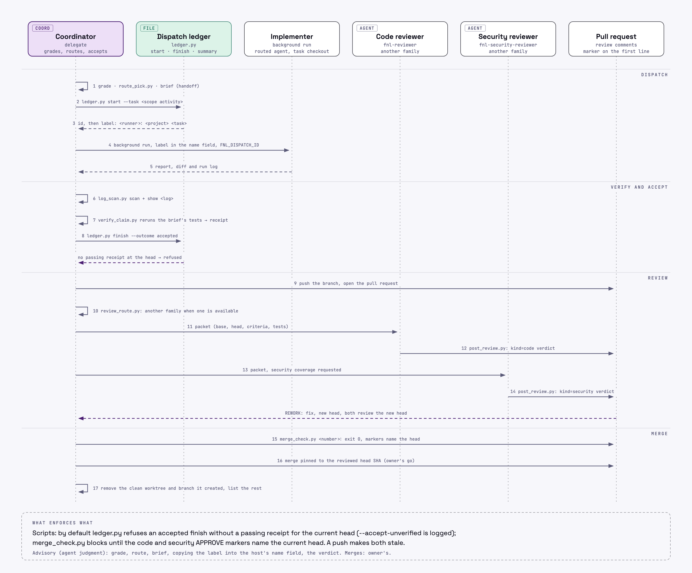
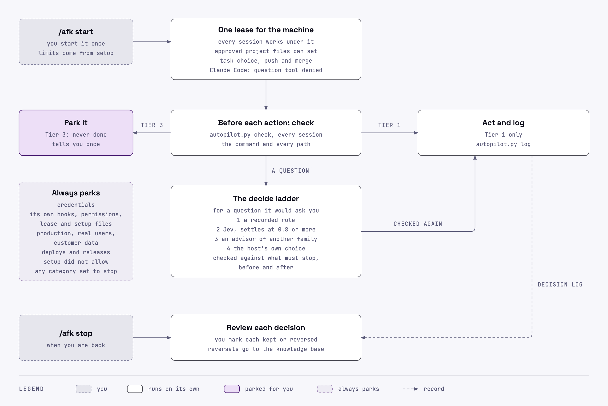

# finolabs-vibecode

**In plain words.** finolabs-vibecode gives your AI coding assistant (Claude Code, Codex or Antigravity) instructions and local checks for planning, review and verification. The assistant decides how careful to be, arranges a second look and reports what it checked. Following the instructions is advisory unless a script, gate or host setting enforces the step. You describe what you want; the assistant can guide the technical steps.

**What you hand over, and what stays with you.** You hand over the task. Once set up, the assistant handles the routine within the task and the permissions you give it: it plans, picks how careful to be, runs what it built and arranges a second look at the change. It uses `fnl-advisor` for one second opinion or a committee, `fnl-delegate` for task coordination, and `fnl-session-hygiene` for handovers and shared decisions. It asks you when a decision or action needs your approval, and it tells you what it could not verify. You can change how much runs on its own: see [Bricks, not a framework](#bricks-not-a-framework).

## Install at a glance

[](https://github.com/finolabs/finolabs-vibecode/actions/workflows/validate.yml) [](LICENSE) [](https://github.com/finolabs/finolabs-vibecode/releases/latest)

Run the commands for your host, then open a new chat. See [Install](#install) for trust, verification and single-skill options.

**Claude Code** (in chat):

```text
/plugin marketplace add finolabs/plugins
/plugin install finolabs-vibecode@finolabs
```

**Codex** (in a terminal):

```bash
codex plugin marketplace add finolabs/plugins
codex plugin add finolabs-vibecode@finolabs
```

**Antigravity** (in a terminal):

```bash
agy plugin install https://github.com/finolabs/finolabs-vibecode
```

## Start here (you)

On Codex, use `$` instead of `/` for every skill command below. Claude Code and Antigravity use `/`.

1. **Ask your AI assistant to install it.** Paste this into your assistant's chat: "Install https://github.com/finolabs/finolabs-vibecode for me, and explain each step before you do it."
2. **Open a new chat.** Plugins load when a chat starts.
3. **Type `/fnl-help`.** (Claude Code may show it as `/finolabs-vibecode:fnl-help`.) It tells you in plain words where to start, and you can ask it anything about the plugin.
4. **Type `/fnl-setup`, choose user scope, project scope or both, then Quick.** It asks a few plain questions and changes nothing without your yes.
5. **Check that setup worked.** Type `/fnl-setup check`. It reads your setup, says in plain words what will run on its own and what will ask you first on your host, and lists what is missing. Anything it cannot see from files, it marks unverified.
6. **Say what you want to build, in your own words.** For example: "I run a small shop and want a page that tracks my stock and turns red when an item runs low." The assistant plans it, builds it, checks it and tells you where to see it.
7. **Later, once you have a first result:** type `/fnl-setup instructions` to teach your assistants how you like to work (on Codex, type `$fnl-setup instructions` right after step 4), and `/fnl-status` after a few chats to see how it is going.

## Words you may see

| You may see | It means |
| --- | --- |
| depth (MIN, NORMAL, DEEP) | how careful the assistant is being: a quick tweak, a normal change or a big one |
| review, security review | a second pair of eyes before a change counts, and a safety check for private data and logins |
| commit | a save point |
| pull request | a proposal to add a change to a project |
| branch, worktree | a separate copy to try things safely |
| Spec Kit | a way of writing a plan before building |
| delegate, agent | another AI helper |

## For engineers

One engineering practice for AI coding agents, packaged as a single plugin with a focused skill set. It tells an agent how to route a change, how deep to go, how to delegate to other agents and accept their work, how to commit, version and release, and which review and verification gates a change must pass.

The [0.2.0 changes](CHANGELOG.md#020---2026-11-08) include [review roles, the navigator and verification receipts](docs/specs/agent-roles.md), [setup modes and companions](docs/specs/setup-restructure.md), [run hygiene](docs/specs/run-hygiene.md), [work records](docs/specs/work-tracking.md), [quota on demand](docs/specs/quota-on-demand.md) and [parallel slots](docs/specs/parallel-instances.md). [`route_task.py`](scripts/route_task.py) prints the delegation matrix's tier, effort, budget and family order; the coordinator still selects an available allowed model.

Release 0.2.4 adds [repository checks](docs/specs/checks.md) you can run locally or in a cheaper CI workflow, and an [`/fnl-update`](docs/specs/update-onboarding.md) that walks you through what each new version adds.

Release 0.2.3 adds [`fnl-pause`](docs/specs/pause.md) for draining work before a restart, the [assignment matrix](docs/specs/assignment-matrix.md) that `route_pick.py` answers from, and [away decisions](docs/specs/away-decisions.md): a decision ladder, a record of who decided and a question gate during an away lease. See the [release record](docs/specs/release-0.2.3.md).

This pack owns the decisions between tools: routing, depth, delegation, gates and conventions. For the work itself it points to trusted skills and native commands from known publishers (Matt Pocock's skills, Cloudflare's security audit, Spec Kit, each host's own review commands) instead of rewriting them, and every such pointer carries a fallback that keeps the skill working when the companion is not installed.

### Compaction steward

After `fnl-setup` records your chosen native threshold, `fnl-session-hygiene` checks supplied token usage with `scripts/context_steward.py`. The script returns `ok` below 80% of that threshold and `prepare` from 80% to below it. At the threshold it returns `wait` while a unit of work is unfinished, otherwise `compact`: ask you to compact, or propose a fresh session with a handover after the story closes. The host enforces its threshold; the model judges the safe boundary, with one bounded Jev question when needed and authorized. No threshold is invented, no session is started and no compaction command is sent automatically. A `compact` result with an unknown boundary still needs the agent to settle that boundary; it is not permission to compact.

On `prepare`, the working agent writes its handover through `python3 -I <plugin root>/scripts/handover_state.py write --session <id>` (optional `--repo <code>`), with UTF-8 text on stdin. `read --session <id>` returns only safe text younger than 24 hours. The local file is private (0600 in a 0700 folder), limited to 8 KiB, and never sent by these scripts or included in metrics; at most 20 files are kept. The existing session-start hook appends it on source `compact`. Writing the handover and running the threshold script are advisory agent actions; the scripts enforce the limits and action table. Vendor docs (07/11/2026; Codex 0.167.0) document SessionStart `source: compact` delivery on both Claude Code and Codex; live delivery/order in this plugin remains unverified. Claude Code PreCompact stdout feeds summary instructions; on Codex a plain-text reminder does not reach the model. Write the handover on `prepare`, before compaction (advisory, agent judgment). The standalone `fnl-session-hygiene` skill carries the threshold script and keeps the manual handover procedure; automatic handover re-injection requires the plugin. See the [design and acceptance criteria](docs/specs/compaction-steward.md) and [privacy details](PRIVACY.md#compaction-handover).

Claude Code and Antigravity (not Codex): when you opt in through `fnl-setup`, your status line records the current context size (token counts only, no conversation content) with `scripts/context_snapshot.py record`. `read` and `check` then give the steward a fresh real reading, and, on Claude Code, session start shows it. Setup never edits an existing status line; it prints a recipe instead. See the [design](docs/specs/context-snapshot.md).

| Optional compaction control | Behavior and limits |
| --- | --- |
| [Antigravity compaction stop](docs/specs/compaction-stop.md) | Separate opt-in and preview in `fnl-setup`; a user-chosen 50000–20000000 byte limit can stop a `PreInvocation` with `invocationNum` 0 and ask for `/compact` or a fresh session (the fixed message still names `/compact`). Bytes exclude the system prompt and are only a rough proxy; no default is recommended. The local hook never reads transcript content or sends data, allows on errors, and stops again only after both 10% and 20000 bytes of growth. `FNL_COMPACT_STOP=off` disables it; previewed `--remove` removes its own group. Vendor docs through Antigravity 1.5.3 (07/11/2026) confirm user-level hooks; live delivery and TUI behavior remain unverified, as does the assumption that `invocationNum == 0` marks the first model call of each user turn. `/compact` may not exist; use `/new` or `/fork`. The fixed script message is unchanged pending an owner decision. See [privacy](PRIVACY.md#compaction-stop). |

### How the skills fit together

<p align="center">
  <picture>
    <source media="(prefers-color-scheme: dark)" srcset="assets/skills-architecture-dark.png">
    
  </picture>
</p>

### Life of a change

<p align="center">
  <picture>
    <source media="(prefers-color-scheme: dark)" srcset="assets/task-lifecycle-dark.png">
    
  </picture>
</p>

### One delegated task, and a decision while you are away

Two sequence diagrams follow the agents step by step. [One delegated task, dispatch to merge](docs/diagrams/delegation-sequence-light.html) ([dark](docs/diagrams/delegation-sequence-dark.html)): the coordinator records the dispatch with `ledger.py start`, which prints the run's name, the implementer runs in the background, the coordinator verifies and accepts against a receipt, reviewers of another family (when one is available) post their markers and `merge_check.py` passes before the merge. [A decision while you are away](docs/diagrams/away-decision-sequence-light.html) ([dark](docs/diagrams/away-decision-sequence-dark.html)): the question gate denies the question tool during a lease, the host climbs the ladder (a recorded rule, Jev at 0.8, an advisor of another family in choose mode, its own choice), checks twice against what must stop, parks or records the attempt with `autopilot.py log`, and on return you mark each decision kept or reversed.

<p align="center">
  <picture>
    <source media="(prefers-color-scheme: dark)" srcset="assets/delegation-sequence-dark.png">
    
  </picture>
</p>

<p align="center">
  <picture>
    <source media="(prefers-color-scheme: dark)" srcset="assets/away-decision-sequence-dark.png">
    
  </picture>
</p>

The sources of all four diagrams are in [`docs/diagrams/`](docs/diagrams/).

### Bricks, not a framework

The pack is a set of small skills that each do one job, plus a guideline that shows how we combine them. Follow the guideline, or assemble your own set.

The modular approach was inspired by the LEGO Group's turnaround under Jørgen Vig Knudstorp: a small set of parts that fit together. This project is independent of, and is not sponsored or endorsed by, the LEGO Group. LEGO is a trademark of the LEGO Group.

The main preferences are yours. They live in host config: `## Delegation mode`, `## Routing` and `## Agents on this machine`. Setup asks about them:

- **Delegation mode.** `manual`: other agents get work only when you say so. `suggest` (default): the agent names who could take a task and waits for your yes. `auto`: it hands off bounded tasks by the guideline, records the decision in the ledger and tells you after.
- **Agents.** Present agent families and user-confirmed allowed models. Delegation uses only present families; with no other family present it is off. A missing inventory keeps previous behavior and suggests a scan; an inventory older than 30 days prompts a stale warning once per session.
- **Routing.** `on` (default) or `off`. Off removes the Claude Code/Codex session-start router reminder; the skill still works when called by name. Antigravity's static always-on rule cannot honor this switch.
- **Parallel runs.** The user sets a total from 1 to 32 and optional per-family caps in `/fnl-setup add delegation`. The limit is per repository; a missing setting defaults to 3 and a malformed one reads as unknown. [`parallel_slots.py`](docs/specs/parallel-instances.md) checks advisory capacity snapshots, not reservations; the ledger does not enforce these limits.

For Delegation mode `auto`, `/fnl-setup mode auto-gate on` offers a separate opt-in with a clear Yes or No. On Claude Code, the installed hook may deny the first file write in a repository without a decision in the last 8 hours; a recorded decision or prior denial allows later writes in that window, and expiry can cause one more denial. The hook allows on errors. It does not cover shell commands and is not an approval or security control. Turn it off with `/fnl-setup mode auto-gate off` or `FNL_AUTO_GATE=off`. Antigravity and Codex have no auto gate declaration; agent judgment remains advisory there. Real-session delivery of this implementation is not verified.

Setup is user-invoked on Claude Code through `disable-model-invocation: true`. Codex and Antigravity have no verified equivalent; their invocation policy remains unverified.

Type `/fnl-setup scan` to refresh which helpers are on this machine, and `/fnl-setup mode` to see or change Delegation mode and Routing; both show changes and ask for a clear yes before writing. Environment overrides (`FNL_DELEGATION_MODE`, `FNL_ROUTING`) win over the file; the mode command says when a write has no effect.

Before an agent edits a repository you care about, type `/fnl-restore-point create` to save its current state to a private git ref (nothing is pushed and your branch and files are untouched); a bare `/fnl-restore-point` lists saved points, and restore needs a preview and your clear yes. Non-ignored untracked files, including `.env`, enter the local git object store; never push `refs/finolabs/*`. See the [restore-point procedure](skills/fnl-restore-point/SKILL.md).

These settings govern hand-offs to another model family. Own-family sessions or headless runs follow project rules and may start without an offer for a project requirement or to spare context, with a one-line reason; they retain delegate authority limits. No setting weakens a gate: the review gates and the never-delegated list in `fnl-delegate` (merges, pushes, deploys, secrets) apply in every mode. What a setting guarantees depends on the host. It is agent judgment unless a hook or a host setting backs it; Codex hooks need your trust; Antigravity's always-on rule is a static file that Routing cannot switch off. So `auto` is never 100% automatic. `/fnl-help` explains this in plain words, and `/fnl-setup check` shows what your host enforces.

Suggested combinations, not presets (nothing selects a build for you):

| Build | What you get | Skills |
| --- | --- | --- |
| **Solo** | One implementer that plans before editing, proves its work and writes clean commits | `fnl-coding-router`, `fnl-checks`, `fnl-commit-messages` |
| **Reviewed** | Solo, plus pull requests held for posted code and security reviews | Solo + `fnl-review-gate`, `fnl-security-review-gate` (and the `fnl-reviewer` and `fnl-security-reviewer` agents, which only the plugin install carries) |
| **Whole team** | Reviewed, plus coordination of the agents you have | Reviewed + `fnl-delegate`, `fnl-handoff`; optionally `fnl-advisor`, `fnl-status` |
| **Your own** | Any subset that fits how you work | Any skills; the delegation family needs `fnl-delegate` beside it |

Start any of them with `/fnl-setup` (on Codex, also `$fnl-setup instructions` right after). The lifecycle skills (`fnl-session-hygiene`, `fnl-versioning`, `fnl-update`, `fnl-open-source-review`, `fnl-plugin-packaging`) fit any build when needed. Not sure? `/fnl-help` shows what each skill gives you and what you lose without it.

Published by [FINOLABS](https://github.com/finolabs) and listed in its plugin catalog, [finolabs/plugins](https://github.com/finolabs/plugins). Maintained by [Fioenix](https://github.com/fioenix).

It targets Claude Code, Codex and Antigravity from one `skills/` folder. Release documented here: **0.2.4** (phase 0; see `fnl-versioning` and the [release record](docs/specs/release-0.2.4.md)). Published releases are listed on [GitHub](https://github.com/finolabs/finolabs-vibecode/releases); after this release, `main` moves to `0.2.5-dev`.

<p align="center">
  <picture>
    <source media="(prefers-color-scheme: dark)" srcset="assets/dashboard-dark.png">
    
  </picture>
</p>

The dashboard `fnl-status` opens, drawn here from synthetic numbers (the image may precede the current layout). Its terminal title bar has two tabs: `overview` (activity, coverage and review gate) and `now` (running agents above named projects active in the last 24 hours). The page uses the browser's scrollbar without an inner height cap. Running now uses repository-labelled budget lanes and advisory slot/quota bricks; projects show compact delivery pipelines, task/package bricks and ledger outcome strips. Delegation, Judge receipts and full Reviews stay in Overview's bottom tables disclosure. Running status inside a repository registers its local folder name with metrics consent; `FNL_PROGRESS=off` disables progress. The page reads local usage metadata and the dispatch ledger; nothing leaves your machine ([PRIVACY.md](PRIVACY.md)).

The quickest install: give your coding agent this repository's link and ask it to install the plugin. The next section tells it how.

## For AI agents: install and set up

You were given this repository's link to install it for the user. Follow these steps in order.

1. **Find your host**: Claude Code, Codex, Antigravity, or another agent that reads Agent Skills.
2. **Confirm with the user before installing.** The install changes their agent configuration for every project. Offer the whole plugin by default; it carries the skills, the agents, the session reminder and the hooks for the optional usage metrics (off until the user consents). Offer single skills as the alternative (see [Single skills, any agent](#single-skills-any-agent)). Install only one of the two for an agent, since both together list every skill twice.
3. **Check for an existing install first**: run `claude plugin list` and `claude plugin marketplace list` (or `codex plugin list` and `codex plugin marketplace list`). If `finolabs-vibecode` is already installed from another catalog, such as `finolabs-vibecode@finolabs-vibecode`, or Codex lists the older `Finolabs` catalog, stop and ask the user before switching: two installs list every skill twice, and on Codex the older catalog shares a cache folder with `finolabs`. The [finolabs/plugins README](https://github.com/finolabs/plugins#codex) has the migration.
4. **Install from a shell** with your host's commands:

   | Host | Commands |
   | --- | --- |
   | Claude Code | `claude plugin marketplace add finolabs/plugins`, then `claude plugin install finolabs-vibecode@finolabs` |
   | Codex | `codex plugin marketplace add finolabs/plugins`, then `codex plugin add finolabs-vibecode@finolabs` |
   | Antigravity | `agy plugin install https://github.com/finolabs/finolabs-vibecode` |
   | Other agents | `npx skills add finolabs/finolabs-vibecode -a <agent>` |

5. **Verify** that `claude plugin list`, `codex plugin list` or `agy plugin list` shows `finolabs-vibecode`. Report the command output to the user, and report any failure as it is.
6. **Hand over to the user.** Plugins load when a session starts. Tell the user, in one message and in this order: open a new session; type `/fnl-help` (`/finolabs-vibecode:fnl-help` on Claude Code, `$fnl-help` on Codex); then `/fnl-setup` and choose Quick (`$fnl-setup` on Codex). Only the user can start these, because setup interviews them before it writes host config and instructions. Tell them `/fnl-setup instructions` (choose user scope for their working contract) comes after their first result, except on Codex, where it comes right after setup.
7. **After the first result, offer companion guidance and show install commands only when requested:** [Matt Pocock's skills](https://github.com/mattpocock/skills) and [Cloudflare's `security-audit`](https://github.com/cloudflare/security-audit-skill) (see [Works well with](#works-well-with)). Every skill works without them.

Done when the plugin is listed by your host and the user knows the order: `/fnl-help`, `/fnl-setup` (Quick), a first real task, `/fnl-setup instructions` (immediately after setup on Codex), then `/fnl-status` later.

### For AI agents: working with a new user

- **Start coding work with `fnl-coding-router`.** On Claude Code and Codex a session-start reminder prompts it (unless Routing is off, and Codex hooks need the user's trust) and on Antigravity an always-on rule does; on Codex the user's instructions should also point at it (`$fnl-setup instructions`).
- **A user who says they are new to coding or not technical** should type `/fnl-help` first: it loads the plain-language register, and you keep it for the rest of that conversation. Suggest it once; never start setup for them.
- **Speak in everyday words, lead with the result, and ask only the user's own decisions.** Every check and gate still runs; only the wording changes.


## Skills

The plugin has **24 skill folders**: 12 model-invoked skills and 12 marked user-only on Claude Code. Invocation-policy parity on Codex and Antigravity remains unverified. Every skill carries the `fnl-` prefix. The user types the user-only ones, `fnl-autopilot`, `fnl-afk`, `fnl-brb`, `fnl-pause`, `fnl-gtg`, `fnl-restore-point`, `fnl-setup`, `fnl-status`, `fnl-update`, `fnl-help` and its older name `fnl-ask`, and `fnl-verification`, the older name of `fnl-checks` (`/fnl-setup` on Claude Code and Antigravity, `$fnl-setup` on Codex); `fnl-handoff` and `fnl-advisor` can be typed too. The agent loads `fnl-handoff` directly through `fnl-delegate`, proposes `fnl-advisor` for one opinion or a committee for the user to approve, and loads the rest when the situation calls for them.

| Skill | Use it when |
| --- | --- |
| `fnl-coding-router` | Starting or resuming any coding work, in any repository: depth (MIN, NORMAL, DEEP), review and security gates, proof, the stop-before-a-third-fix checkpoint, and a workflow path for Spec Kit (with its depth gate), mattpocock/skills, obra/superpowers, or none. |
| `fnl-session-hygiene` | Keeping sessions healthy: context pressure, phase changes, stale titles, handovers, and remembering or recalling decisions, lessons and project state in one shared knowledge base (Orrery or an Obsidian vault); code facts stay in the repository. Opt-in Claude Code/Antigravity context snapshots feed the compaction steward; Codex is not covered by the recorder. |
| `fnl-delegate` | Handing work to other agents (Claude Code, Codex, Antigravity) and running it, coordinated from whichever one you run in: grading on five levels with one decision matrix (tier, effort, budget, who accepts), routing by agent and model through a dated capability map and the assignment matrix (`route_pick.py`), the configured judge, quota fallback, parallel runs up to the limit you set for each project, across any mix of agent families, time budgets, liveness from artifacts, the heavy-job lock, verify-before-accept, handover and the dispatch ledger; running a spec as a coordinator with one app session per task, standby sessions and review gates. |
| `fnl-handoff` | Writing a self-contained brief and dispatching one task, or saving a handover through session hygiene so a later session or another agent continues the work. |
| `fnl-advisor` | Getting one second opinion from another model family, or convening two contrasting families for root-cause analysis and a plan when stuck or looping; both are read-only and spend quota, with approval governed by their procedure. During an away lease its choose mode returns exactly one of the given options, or `none`. |
| `fnl-versioning` | Bumping a version, tagging a release, or writing the changelog and release notes: SemVer, `0.y.z` until a stable release is declared, immutable `vX.Y.Z` tags, Keep a Changelog. |
| `fnl-commit-messages` | Committing, writing a pull request description, or working with branches: atomic commits, imperative subjects, no secrets or build output, the host attribution trailer, and the branch flow (naming, base, sync, conflicts, merge, cleanup, backports). |
| `fnl-restore-point` | Saving the working tree to a private git ref before the agent edits, listing restore points and restoring one after a preview and a yes. User-invoked, git repositories only. |
| `fnl-autopilot` | Starting a time-boxed standing mandate while you are away, checking each action against its lease and tiers, and stopping on return. User-invoked; requires recorded setup. Set up with `/fnl-setup add autopilot`. A question it would ask you goes up the away ladder instead (a recorded rule, Jev, an advisor of another family, the host), checked twice against what must stop and recorded with who decided; on Claude Code a question gate denies the question tool during the lease. On return you mark each decision kept or reversed. The live loop, dashboard tab and scheduler are deferred. |
| `fnl-afk` | Main short name for `fnl-autopilot` (away from keyboard); starts the away mandate so your agents keep working while you are away, or stops it on return. |
| `fnl-brb` | Older short name (be right back), kept as an alias of `fnl-afk` through `fnl-autopilot`; follows the same procedure and arguments. |
| `fnl-pause` | Before you restart or shut the machine down: stops new work, lets running work finish, writes handovers and reports what recorded work remains, with an optional `--in <minutes>` deadline; `heavy_run.py` refuses new commands while it is active. User-invoked; never stops a process or declares the machine safe. |
| `fnl-gtg` | Short name (got to go) for `fnl-pause`; follows the same procedure and arguments. |
| `fnl-review-gate` | A user story is done or a pull request is about to merge: an independent code review, a disposition for every finding, a regression test per runtime fix. |
| `fnl-security-review-gate` | A change touches auth, permissions, private data, untrusted input or payments: a permission-boundary review, with negative tests proving that not even a record's existence leaks. |
| `fnl-checks` | Choosing targeted tests, checking current-head verification receipts, completing host/judge criterion checks and deciding whether to accept reported work; the coordinator keeps the verdict. Also runs a repository's stored checks locally (`checks.py run`, set up with `/fnl-setup add checks`), and covers a cheaper CI workflow and what CI minutes cost. |
| `fnl-plugin-packaging` | Packaging skills as a plugin for Claude Code, Codex and Antigravity from one repository: layout, manifests, icon, marketplaces, checks. |
| `fnl-setup` | Configure user scope, project scope or both: Quick confirms inert defaults and asks companion choices; Advanced interviews each companion and offers widening features. `add <feature>` opens one feature, `check` is read-only, `scan` refreshes inventory, `mode` manages Delegation mode and Routing, and `instructions` drafts instruction files with approval per file; setup installs nothing. |
| `fnl-status` | Opening the local dashboard with `overview` and `now` tabs in the terminal title bar. Overview includes a compact review gate and bottom tables for delegation, kept/handed-off counts, Judge receipts and Reviews. Now stacks running-agent lanes, slots and quota above named projects active in the last 24 hours, with compact Spec Kit or repository-state pipelines, task/package bricks and ledger outcome strips. Running status there with consent registers the local folder name. Refresh retains five repository snapshots and recognises Spec Kit artefacts before work records, repository indexes/status lines and packages, then exact-project ledger runs, skipping `specs/archive`; unrecognised projects retain their simple activity row and a searched-sources tooltip. `FNL_AGENT_SNAPSHOT=off` disables the opt-in process snapshot; `FNL_PROGRESS=off` disables progress. |
| `fnl-update` | Showing installed and cached available versions, updating through the host after a clear yes, then walking a checklist of what the new version adds; `whats-new` only shows that list. Also targets or pins a chosen version, skips a release, or stops update notices. |
| `fnl-help` | Plugin help: you are new and do not know where to start, want to know what the plugin holds, or have a question about a skill, agent or script; it gives the first steps, lists the contents, explains the piece you name, or maps your situation to the next command, including companion skills from other packs. It answers questions; it does not ask another agent. |
| `fnl-ask` | Older name for `fnl-help`, kept as an alias; follows the same procedure and arguments. |
| `fnl-verification` | Older name for `fnl-checks`, kept as an alias through 0.2.x; follows the same procedure. |
| `fnl-open-source-review` | Before a repository goes public, and after: license, secrets in tree and history, internal leaks, clean payload, community files, repository settings, identity, data flow, plugin checks. |

### Agents

The three agent definitions in `agents/` apply the skills above in a fresh context. They forbid project edits by instruction; their host deny-list covers `Write`, `Edit` and `NotebookEdit`, not every possible mutation tool. Reviewers can prepare a private draft for an authorized post. Native agent loading and tool restrictions depend on the host; Codex and Antigravity review routes use headless runs. Each answers a different question:

| Agent | Question | Use it when |
| --- | --- | --- |
| `fnl-reviewer` | Is the change good? | A pull request or story is ready: it reads changed hunks and their impact set, or identifies coverage supplied by a native review engine, under `fnl-review-gate`. |
| `fnl-security-reviewer` | Is the change safe? | The change crosses a sensitive boundary: it reads the changed files, then every trust path that reaches them, under `fnl-security-review-gate`. |
| `fnl-navigator` | Is the project on course? | Compare confirmed outcome anchors with bounded repository evidence, report unsupported work and at most three ways to steer back, and edit nothing. [Navigator design and validation limits](docs/specs/agent-roles.md#g-the-navigator). |

Headless dispatch forms use `delegate_env.py` and `run_env.py` for an environment allowlist and `brief_check.py` to lint the brief; finished logs are scanned locally and read through `log_scan.py show`. HOME remains reachable: protection is environment-only, excluding interactive, desktop-app sessions and in-session subagents; private HOME is deferred. See [run hygiene and its limits](docs/specs/run-hygiene.md).

Configure roles through `/fnl-setup add roles`, or through the assignment matrix in `/fnl-setup add delegation`, which decides when it is valid and consented: `review_route.py` chooses the review family before the run, prefers independence and discloses same-family fallbacks; `post_review.py` is the guarded posting path, and posting is marked verified only after observing the expected author and marker. On Claude Code and Codex, SessionStart prints fixed roles, judge and posting words alongside delegation, cached quota, open dispatch counts and parallel capacity; failures never block startup. Relay receipts/counters remain unimplemented. See [roles and posting](docs/specs/agent-roles.md) and [verification receipts](skills/fnl-checks/SKILL.md#accepting-someone-elses-work).

Both reviewers cover two rings, the change and its impact set, rather than the whole repository, and report what they traced. The coordinator verifies delegated work with `fnl-checks` and its self-contained `verify_claim.py`; ledger acceptance requires a passing receipt for the checkout's current head, or a logged `--accept-unverified --reason` exception. A pull request merges only after the reviewer and the security reviewer have each posted an approving review comment for its current head commit; a push after a review needs a new review. Where a repository adopts the low-risk lane, a pull request that only modifies the allowlisted root documents written for people (such as this README or the changelog) or the manifests' top-level versions takes one pass by the reviewer, which posts both comments; a script decides which pull requests qualify. `skills/fnl-review-gate/scripts/merge_check.py` runs the merge check and the lane check, and requires exactly one valid router marker when the base commit adopted the gate. A story closes only after verification and both required reviews pass.

## Supported platforms

macOS and Linux are supported. Native Windows is not: the plugin's scripts rely on POSIX file APIs (`pwd`, `fcntl`, `flock`, descriptor-relative opens and `O_NOFOLLOW`), so on Windows a script you run by hand stops with one clear message, while the plugin's hooks stay fail-open and never block a session. Windows users run Claude Code, Codex or Antigravity with the plugin under WSL.

## Install

Every install path ships the same `skills/` folder. Install the whole plugin on a host, or pick single skills with [skills.sh](https://skills.sh). Choose one way per agent, because both together list every skill twice.

Claude Code and Codex install the plugin from the [FINOLABS catalog](https://github.com/finolabs/plugins), marketplace `finolabs`, which groups the FINOLABS plugins together. This repository also remains its own marketplace (`finolabs-vibecode@finolabs-vibecode`) for existing installs. The catalog selects the installed ref; direct installs from this repository track `main`, which moves to `0.2.5-dev` after 0.2.4. Releases are the `vX.Y.Z` tags, with notes in `CHANGELOG.md` and on GitHub.

### Claude Code

```text
/plugin marketplace add finolabs/plugins
/plugin install finolabs-vibecode@finolabs
```

From a shell or an agent, run `claude plugin marketplace add finolabs/plugins`, then `claude plugin install finolabs-vibecode@finolabs`. Skills are namespaced, for example `/finolabs-vibecode:fnl-handoff`. To try a local checkout for one session: `claude --plugin-dir /path/to/finolabs-vibecode`.

### Codex

```bash
codex plugin marketplace add finolabs/plugins
```

```bash
codex plugin add finolabs-vibecode@finolabs
```

Codex runs a plugin's hooks only after you trust them: open `/hooks` once in a new session. Until then plugin hooks cannot run. Codex 0.167.0 [hooks docs](https://learn.chatgpt.com/docs/hooks) and pinned [vendor source](https://github.com/openai/codex/tree/rust-v0.167.0), researched 07/11/2026, bind trust to normalized event, matcher and handler definitions plus the plugin bundle's file bytes. The bundle fingerprint covers paths and contents, excluding `__pycache__`, `.venv`, `*.pyc` and `*.egg-info`; changing bundled scripts can require renewed trust with unchanged declarations. Check trust after a plugin update. This plugin's live update check and notice remain unverified on Codex.

### Antigravity

```bash
agy plugin install https://github.com/finolabs/finolabs-vibecode
```

The following distinguishes shipped support from live delivery; local tests do not prove a host ran a hook.

| Surface | Claude Code | Codex | Antigravity |
| --- | --- | --- | --- |
| Router reminder and startup summary | SessionStart hook | SessionStart hook after trust | Static router rule; no SessionStart summary |
| Usage hooks | Bundled, opt-in | Bundled, opt-in; no skill/agent-use events | Separate previewed user hook, opt-in |
| Context snapshot | Opt-in status-line command; desktop Code-tab delivery unverified | Not covered by this recorder | Opt-in status-line command; no startup Context line |
| PreCompact reminder | Stdout feeds summary instructions | Plain stdout does not reach the model | No declaration |
| Compaction handover re-injection | Declared on compact SessionStart; live order unverified | Declared on compact SessionStart; live order unverified | No automatic re-injection |
| Auto gate / rate-limit marker | Opt-in auto gate and quota StopFailure marker; live delivery unverified | Neither declared | Neither declared |
| Update check / update command | Startup check/notice verified; native `plugin update` help checked | Check/notice and update procedure unverified; recheck hook trust after updates | No automatic check hook; update procedure unverified |

See [context snapshot](docs/specs/context-snapshot.md), [compaction delivery](docs/specs/compaction-steward.md#2-re-injection), [quota](docs/specs/quota-on-demand.md) and [update limits](skills/fnl-update/references/hosts.md) for the recorded contracts and remaining live checks.

### Single skills, any agent

```bash
npx skills add finolabs/finolabs-vibecode
```

The installer lists the skills to choose from; `--skill <name>` takes one directly and `-a <agent>` picks the agent. It copies editable files into your project (or, with `-g`, for every project); update them with `npx skills update`. The plugin path also carries the agents, the session hook and the Antigravity rule, which single-skill installs leave out.

Single-skill installs keep each folder self-contained, with these dependencies: setup’s `scan` subcommand uses the `fnl-delegate` tier table (or leaves models unverified without it); for dispatch and advice, `fnl-handoff` Dispatch and `fnl-advisor` need `fnl-delegate` beside them; headless dispatch also needs `fnl-handoff`'s brief linter; `fnl-handoff` Resume needs `fnl-session-hygiene`; `fnl-status` shows the usage events without it and adds the dispatch ledger when it is there. Other skills mention their neighbors by name and work without them. A sensible first pick: `fnl-coding-router`, `fnl-checks`, `fnl-review-gate`, `fnl-commit-messages`, plus `fnl-setup` to configure them.

### Setup commands

Use `/fnl-setup` for the core, `/fnl-setup add <feature>` for one optional feature, `/fnl-setup instructions` for instruction files, `/fnl-setup check` for a read-only check, `/fnl-setup scan` for inventory and `/fnl-setup mode` for Delegation mode and Routing; on Codex use `$` instead of `/`.

The features `add` opens:

| Feature | What it sets |
| --- | --- |
| `delegation` | Which helpers take work, the parallel limit per project, and the assignment matrix: levels, types of work, model and roles per agent, plus the judge, written in one pass to `## Assignment matrix` |
| `autopilot` | The away mandate: hosts, limits, the quota floor, which categories stop or are decided during a lease (two always stop), optional `Non-production targets`, a separate consent for precedent excerpts, and Merge |
| `roles` | Review roles, the judge and review posting in `## Agent roles`; a valid matrix with its own consent decides instead |
| `project` | Per-repository ledger and task-file settings |
| `quota` | The opt-in quota probe |
| `metrics` | Usage-metrics consent and retention, then project progress, the process snapshot and the Antigravity usage hook |
| `compaction` | The native compaction threshold, context snapshots and the opt-in Antigravity compaction stop |
| `companions` | Companion skills, with install commands shown only on request |

### First check

Ask your agent: "Route this change through the coding router and tell me the depth you chose." It should load `fnl-coding-router`. After the task, ask which checks ran, what they showed and what remains unverified. On Codex, complete `$fnl-setup instructions` before this first task.

## Getting started in detail

The short version is "Start here" above; the order is `/fnl-help`, `/fnl-setup`, a first real task, then `/fnl-setup instructions` (right after setup on Codex) and `/fnl-status`.

1. **Install** for your host (above), then open a new session: plugins load when a session starts.
2. **Type `/fnl-help`** (`$fnl-help` on Codex). It explains where to begin. For a beginner, it loads plain-language guidance that the agent follows for the conversation.
3. **Run setup once**: `/fnl-setup` (Claude Code, Antigravity) or `$fnl-setup` (Codex). Choose user scope, project scope or both first, then Quick for recommended defaults and a confirmation before writing, or Advanced to decide each part. The beginner path uses plain questions within the chosen scope and defers technical choices. The user-scope core runs `/fnl-setup scan` before configuring reach; Quick then asks one companion multi-select question and at most four separate offers to show install commands; Advanced interviews each companion and offers the widening features afterwards. Setup installs nothing; usage recording needs its own consent. On Codex, type `$fnl-setup instructions` next so your instructions point coding work at the router from the first task.
4. **Give it a first real task.** Ask for a change; the agent starts coding work by loading `fnl-coding-router`. It chooses a workflow and depth (MIN, NORMAL or DEEP), checks the result, and explains what happened in your register within the same chat. On Claude Code and Codex a session-start reminder prompts the router (Codex hooks need your trust) and on Antigravity an always-on rule does; setting Routing to off removes the Claude Code/Codex reminder, while Antigravity's static rule stays.
5. **What you should see:** a stated depth and reason, expressed in everyday words for a beginner; commits written as `fnl-commit-messages` says; pull requests held for posted code and security reviews (the adopted low-risk lane can use one reviewer for both); sensitive boundaries add the full security procedure; and, if delegation is set up, bounded tasks whose results are checked before acceptance.
6. **After your first result**, type `/fnl-setup instructions` to set how your assistants work with you (already done after setup on Codex). After a few sessions, type `/fnl-status` to see how the practice is working, if you consented to usage metrics. Return to `/fnl-help` whenever you need help with a skill.
7. **Go further** when you need it: [Host configuration](#host-configuration) for delegation, [Usage metrics](#usage-metrics) for what is recorded and where, and [Works well with](#works-well-with) for companion skills.

| Setup mode | Core decisions | Companions and extras |
| --- | --- | --- |
| Quick | Confirm recommended inert defaults once; grants keep their own questions. | One multi-select question, then "Show me how to install" / "Not now" per selected companion, at most four. Only "none of these" records `companions: declined`; explicit `add companions` asks again. |
| Advanced | Ask each inert item; grants keep their own questions. | Interview each companion about benefit, a stack example, costs/data and fallback before the same neutral offer; optional roles/judge, quota, metrics, compaction, project settings and review instruments. |
| Beginner | Plain questions and Quick inert defaults; grants keep their own questions. | Skip companion questions and defer extras. |

Companion choices never install anything: a Yes prints a checked command, a No records nothing, and defaults or timeouts grant nothing. Setup's [`companions` feature](skills/fnl-setup/references/features/companions.md) uses the [checked companion table](skills/fnl-setup/references/companions.md), including markmap for mind maps and outlines. `typesafe-ai` is optional cookbook guidance; the plugin's `judge.py` makes calls without it.

## Works well with

These skills set the gates and the routing; they do not try to replace good phase tools. They pair with [Matt Pocock's skills](https://github.com/mattpocock/skills) (MIT): `tdd` and `diagnosing-bugs` inside the work `fnl-coding-router` routes, `code-review` as the reviewer's instrument in the review gate, `grilling` and `prototype` for clarification, `pr` for pull request bodies, and `handoff` for portable handovers. Install that pack with its own instructions; `/fnl-help` points to its skills when they fit. The two packs are independent projects.

For reviews, the gates and the `fnl-reviewer` agent use each host's native instruments: `/code-review`, `/security-review` and `claude ultrareview` on Claude Code, `codex review` on Codex. Antigravity has no native review command, so it reviews by reading the diff, and the native second pass runs on Claude Code or Codex. For security audits, the security gates recommend [Cloudflare's `security-audit` skill](https://github.com/cloudflare/security-audit-skill) (MIT):

```bash
npx skills add https://github.com/cloudflare/security-audit-skill --skill security-audit
```

`fnl-setup` offers companion guidance in Quick or Advanced, each where it fits: [`agybird`](https://github.com/finolabs/agybird) (MIT), which runs Antigravity dispatches for `fnl-delegate` when Antigravity is a delegate of Claude Code or Codex, and [`vietnamizer`](https://github.com/finolabs/vietnamizer) (MIT), which writes and edits Vietnamese documents for people. The setup companion table uses pinned single-skill install commands; plugin installs from the `finolabs` catalog are an alternative, and users should choose one path per host. For diagrams in docs, the README or a deck, it also suggests [`diagram-design`](https://github.com/cathrynlavery/diagram-design) (MIT, by Cathryn Lavery), which draws them as self-contained HTML or SVG with PNG export; it sends nothing to its author, and a generated file loads its fonts from Google Fonts when opened. For mind maps and outlines it offers [`markmap`](https://github.com/finolabs/markmap-skills); optional [`typesafe-ai`](https://github.com/typesafe-ai/skills) supplies judgment cookbooks. Use the [checked companion table](skills/fnl-setup/references/companions.md) for install commands, dates, data costs and fallbacks.

## Usage metrics

Off until you say yes in `/fnl-setup add metrics`, where you also pick how long events are kept: 30, 90 or 365 days. Hooks then record metadata about your own sessions on your machine: a time, a session id, a short code derived from the repository path, the name of an `fnl-` skill or agent that ran, the router's depth, a review verdict, and the number of tasks a coordinator kept with a fixed reason and who settled it, plus task identifiers, delegated run identifiers and judge receipt site, grader, result and followed status. They never record prompts, code, command text, file paths or review text, and metrics send nothing anywhere ([PRIVACY.md](PRIVACY.md)). `fnl-status` opens the dashboard drawn from them.

| Host | What is recorded |
| --- | --- |
| Claude Code | sessions, skill and agent use, first edits, commits, review comments, the router's depth, keep/task/judge receipts and dispatch identifiers |
| Codex | the same without skill and agent use; trust the hooks once with `/hooks` |
| Antigravity | the same as Codex; its hook is not part of the plugin, and setup adds it to your own `~/.gemini/config/hooks.json` only after a clear yes (`refresh.py antigravity-hook`, with a backup; `--remove` takes it out) |

Events are best effort: they are read from tool calls and command text, so they can miss an action. Stop recording with `FNL_METRICS=off` or ask `fnl-status` to withdraw consent; it asks you first, then runs `refresh.py consent --revoke --yes`; delete what was recorded with `fnl-status purge`.

## Update check

On by default, independently of usage metrics consent. The check and startup notice are verified on Claude Code and unverified on Codex and Antigravity; Codex ships a hook, while Antigravity has no automatic update hook. A startup hook reads a local cache and starts a detached worker when it is missing or at least 24 hours old. The update worker makes one network call: one HTTPS GET to `https://api.github.com/repos/finolabs/finolabs-vibecode/releases/latest` with generic User-Agent `finolabs-vibecode-update-check`. It sends nothing about the user, repository, session or installed version. GitHub sees the connection's source IP. Only a timestamp and validated stable release tag are cached; no response text is displayed. Failures stay silent and the session continues.

A newer stable version prompts the agent to let the user know they can type `/fnl-update` (on Codex `$fnl-update`), at most once per session. That skill shows the installed and cached available versions, asks for a clear yes before a native update, and records “skip this version” or “never ask” when requested. Claude Code needs a restart after updating; Codex hooks may require renewed trust through `/hooks`, including after bundled script changes (0.167.0 vendor source, 07/11/2026). The Codex refresh (catalog upgrade, remove and add the plugin, then trust its hooks again) was verified on 2026-11-09; the Antigravity procedure is still unverified, and the skill explains that limit. After an update, `/fnl-update` walks a checklist of what the new version adds; `/fnl-update whats-new` only shows it. The first carrying stable release gives no notice of itself. Set `FNL_UPDATE_CHECK=off` to stop requests and notices; “never ask” suppresses notices only. Antigravity has the skill but no automatic update hook. See [PRIVACY.md](PRIVACY.md) and the [spec](docs/specs/update-check.md).

## Where the plugin keeps its files

The data root defaults to `~/.finolabs/vibecode/`, using the account home from the operating system. Only `fnl-setup` changes it.

| Path under the data root | Holds |
| --- | --- |
| `host.md` | host settings and opt-ins |
| `ledger.jsonl` | dispatch ledger |
| `state/` | consent/events and dashboard; update, auto-gate and quota state; private handovers, context snapshots, verification receipts, review drafts and setup previews (see [retention and purge boundaries](PRIVACY.md)) |
| `logs/`, `bin/` | plugin logs and helpers |
| `tmp/` | private transient files |

In setup's **Data location** step, keep the default (recommended) or name an absolute local folder outside every git work tree. Setup previews the regular files to copy and a digest binding their contents and the target. After a separate clear yes and the full 64-hex preview digest (no prefix), it copies into an empty folder, with folders mode `0700` and files mode `0600`, then publishes the pointer atomically. It skips symlinks, special files and `tmp/`, leaves the old folder untouched, and asks you to remove it yourself when ready. Check and the agent scan report the effective root and its source.

The fixed anchor `~/.finolabs/vibecode/root.json` contains the new absolute `root` and a random `id` matching the new folder's `.root-id`. A present but invalid pointer turns consent-bearing reads off; the default's old opt-ins cannot reactivate them. The root, pointer and each opened component must pass ownership and no-follow checks; relocated roots and their ancestors cannot be group- or world-writable. Network file systems and Windows are unverified and unsupported for relocation.

A home folder that other users can write to lets them swap folders under it, so keep your home folder private.

`HOME`, `XDG_*`, `FNL_STATE_DIR` and `ORCHESTRATION_HOST_CONFIG` cannot redirect consent, opt-ins, auto gate or quota files. The absolute `FNL_STATE_DIR` override and the older `${XDG_STATE_HOME:-~/.local/state}/finolabs-vibecode` folder remain compatibility paths only for usage events and the dashboard; the older folder is used only before relocation, while the default state folder is absent. Metrics atomic-write temporary files stay beside their destination, including on these compatibility paths. `ORCHESTRATION_HOST_CONFIG` still selects non-consent settings such as Delegation mode. The ledger no longer follows environment overrides. Each host's own configuration and project-local `.finolabs/` briefs/logs stay in their existing locations. [Restore points](skills/fnl-restore-point/SKILL.md) live in the repository's git object store under `refs/finolabs/restore/`, outside the data root and metrics purge.

## Host configuration

Optional quota probing is configured in `/fnl-setup add quota`, off by default and independent of metrics. After a confirmed path preview, the coordinator runs `quota_probe.py read --family <agy|claude|codex>` before routing, then `status`. The command waits for each install's reading and enforces a minimum 15-minute age, failure backoff and one in-flight reading. Hooks start no quota reading; Claude Code alone records a family-and-time marker on StopFailure `rate_limit`, with probing on. A newer successful reading overrides this advisory marker; otherwise it expires at an eligible depleted pool's reset or after one hour, never over five hours. Claude Code asks to trust the changed hooks; Codex and Antigravity have no new hook entry. Claude Code vendor hooks docs (07/11/2026) verify the StopFailure `error: rate_limit` contract, with no token counts and ignored output/exit code; the live payload and this plugin's delivery remain unverified before release (see the [quota spec](docs/specs/quota-on-demand.md)). The programs contact their providers; the probe itself makes no network call. `FNL_QUOTA_PROBE=off` disables it. Scan and Check show per-install labels, measured times and pools; routing treats the cache as advisory, excludes nothing older than eight hours, and defers to the user. See [privacy](PRIVACY.md#quota-probe) for the stored fields, Claude configuration behavior and verification limits.

Project progress uses per-repository ledger and task-file settings confirmed in `/fnl-setup add project`, while `/fnl-setup instructions` writes the project work convention and dated Outcome anchors. These settings, the parallel limit and the dashboard label live in each repository's own settings file, `.finolabs/vibecode/settings.json` in the main checkout (kept out of git through `.git/info/exclude`, and read only while it matches the digest approved in the data root). Since 0.2.5 the `## Project settings` and `## Project labels` sections and the global `Ledger project:` and `Task file:` lines of `host.md` are no longer read: set them again per repository, then delete them by hand.

Parallel capacity is user-set, advisory and shared across coordinators; [slot checks](docs/specs/parallel-instances.md) do not reserve capacity.

The orchestration skills keep machine facts (agent commands, allowed models, reachable delegates, the configured judge, allow-rules, heavy-job limits) in `host.md`; the parallel limit is a per-project setting in that repository's approved settings file, `.finolabs/vibecode/settings.json` of the main checkout. Start from `skills/fnl-delegate/references/host-template.md`. File-backed opt-ins and Routing come from that canonical file; `FNL_ROUTING` can override Routing, and opt-in environment switches can disable collection; `ORCHESTRATION_HOST_CONFIG` applies only to non-consent settings. Put the data root where every coordinator's sandbox can read and write it, using setup's relocation step when needed.

The judge defaults to a small host model. Choose Jev through `fnl-setup` only with authorization and API budget: `Judge: jev` in `## Assignment matrix` (`add delegation`), which alone decides when it is present and valid with its own consent, or `judge: jev` in canonical `## Agent roles` (`add roles`) when there is no matrix; `judge.py` calls TypeSafe directly using `TYPESAFE_API_KEY` from the process environment. The call uses the scoped Jev network exception; the optional `typesafe-ai` skill supplies cookbooks and is not required for calls. Both judges inform bounded semantic decisions; the host fallback is reported when Jev is unavailable. Neither judge grants acceptance or authority.

## Layout

```text
.claude-plugin/plugin.json        Claude Code manifest (the version's single source of truth)
.claude-plugin/hooks.json         Claude Code hooks: the session reminder, the update notice, usage metrics, the PreCompact reminder, the opt-in auto gate, the away question gate and the advisory StopFailure hook
.claude-plugin/marketplace.json   Claude Code marketplace listing this repository
.codex-plugin/plugin.json         Codex manifest, version kept equal
.codex-plugin/hooks.json          Codex hooks for the session reminder, update notices and usage metrics (named by the manifest)
.antigravity-plugin/plugin.json   Antigravity manifest, version kept equal
.agents/plugins/marketplace.json  Codex marketplace listing this repository
agents/fnl-*.md                   code reviewer, security reviewer and navigator definitions (no project edits; authorized posting uses a private draft)
agents/openai.yaml                Codex skill-list display metadata
skills/fnl-*/SKILL.md             self-contained skills, model-invoked or flagged user-only on Claude Code
skills/fnl-advisor/references/committee.md       committee procedure, loaded only for a committee
skills/fnl-advisor/references/choose.md          choose mode: one option or none during an away lease
skills/fnl-autopilot/references/decide.md        the away decision ladder, its two checks and the record of each attempt
skills/fnl-delegate/references/coordinator-sessions.md  spec coordinator and task sessions
skills/fnl-help/references/map.md                every skill, agent, script and setup feature; a test fails when a script or feature is missing
skills/fnl-session-hygiene/references/knowledge.md      remember/recall procedure; handovers live in SKILL.md
rules/AGENTS.md                   session-start reminder: an always-on rule on Antigravity, printed by scripts/session_start.py on Claude Code and Codex
assets/                           icons, light/dark architecture and task-lifecycle diagrams, dashboard screenshots and their NOTICE
evals/                            trigger, behavior and parity cases for `claude plugin eval`
scripts/                          repository/shared helpers and checks: routing, reviews, receipts, judge, context, hygiene, slots, quota, metrics and setup; shared helpers have byte-identical copies in consuming skills
skills/fnl-*/scripts/             self-contained copies plus skill-only helpers; the full inventory is in fnl-help/references/map.md
docs/specs/                       design specs (index.md) and one-file work records; work-tracking.md defines their contract
docs/diagrams/                    HTML sources of the architecture, task-lifecycle, delegation sequence and away decision sequence diagrams
tests/                            unit tests for the repository scripts, the ledger, the metrics hook and the dashboard page (the page script runs in node when it is installed)
CHANGELOG.md                      Keep a Changelog
LICENSE                           MIT
```

## Validate

```bash
claude plugin validate . --profile directory
```

```bash
agy plugin validate . --strict
```

```bash
claude plugin eval . --tag trigger --ablation none
```

```bash
claude plugin eval . --tag quality --ablation none --scaffold
```

The trigger cases check that each skill fires on a representative prompt and that unrelated prompts load none; the quality cases grade what a skill makes the agent decide. The `behavior` cases, a subset of `quality`, are the ones to rerun after changing a skill's rules. The repository root `CLAUDE.md` is context for agents working on this repository; the validator warns that a plugin does not load it, which is intended.

## Contributing

See [CONTRIBUTING.md](CONTRIBUTING.md). Everyone taking part follows the [Code of Conduct](CODE_OF_CONDUCT.md). Report vulnerabilities as [SECURITY.md](SECURITY.md) describes.

## License

MIT. See [LICENSE](LICENSE).

## Acknowledgements

This pack stands on other people's work. Thank you to:

- **Matt Pocock** and [mattpocock/skills](https://github.com/mattpocock/skills) ([overview](https://www.aihero.dev/skills)), MIT. Its `/setup-matt-pocock-skills` and `/ask-matt` skills inspired `/fnl-setup` and `/fnl-help`; its user-invoked and model-invoked split, its grilling interview and its `writing-for-agents` guidance shaped how these skills are written. No text is copied, and the two packs are independent projects.
- [kepano/obsidian-skills](https://github.com/kepano/obsidian-skills) by Steph Ango, MIT, which `fnl-session-hygiene` recommends for Obsidian vaults.
- Orrery, the FINOLABS knowledge base for agents that `fnl-session-hygiene` recommends where it is available (not yet published).
- [Cloudflare's security-audit skill](https://github.com/cloudflare/security-audit-skill), MIT, which the security gates recommend for audits.
- [Spec Kit](https://github.com/github/spec-kit) by GitHub, which `fnl-coding-router` routes through first.
- [Superpowers](https://github.com/obra/superpowers) by Jesse Vincent, whose process skills (brainstorming, systematic debugging, test-driven development, verification before completion, code review requests) carry the steps of the router's superpowers path.
- [Paseo](https://github.com/getpaseo/paseo), whose advisor, committee and handoff skills were the reference design for the delegation skills.
- Anthropic's [skills repository](https://github.com/anthropics/skills) and its `skill-creator`, and the [Agent Skills](https://agentskills.io) format that lets one `skills/` folder serve several hosts.
- The packaging documentation of [Claude Code](https://code.claude.com/docs/en/plugins/manifest-reference.md), [Codex](https://developers.openai.com/codex/plugins/build) and [Antigravity](https://antigravity.google/docs/build-plugins).
- [TypeSafe](https://docs.typesafe.ai), whose cookbooks informed the activity-selection reference.
- [Semantic Versioning](https://semver.org/), [Keep a Changelog](https://keepachangelog.com/en/1.1.0/) and the [Contributor Covenant](https://www.contributor-covenant.org/version/2/1/code_of_conduct/).
